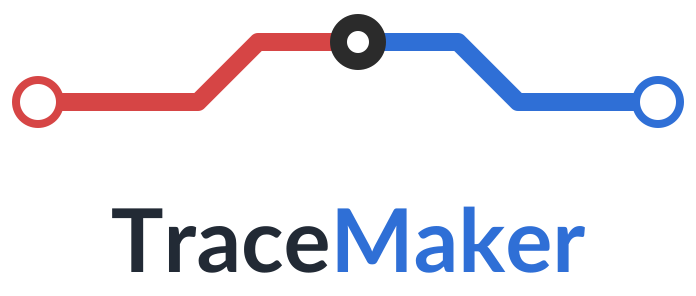
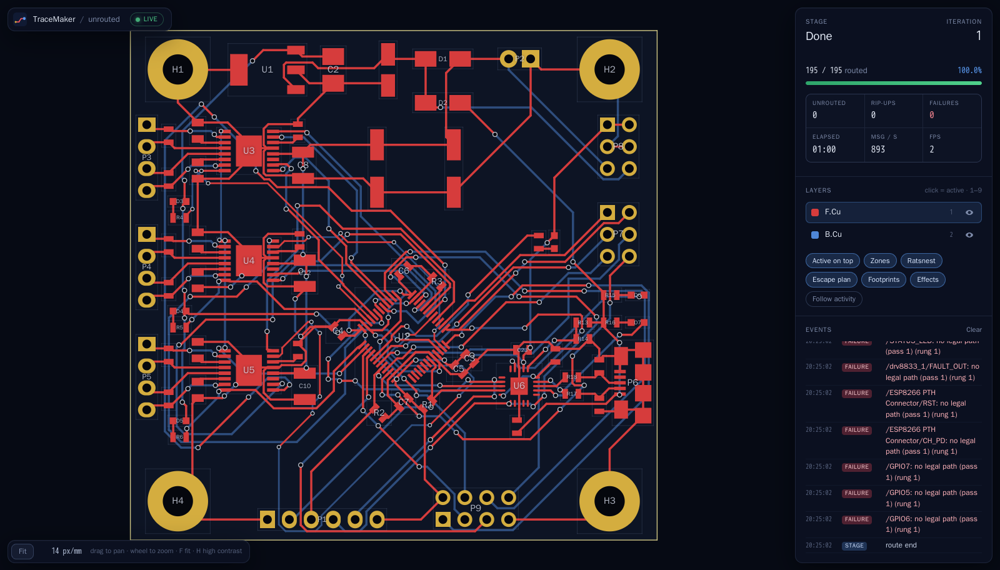

<h1 align="center">
  <picture>
    <source media="(prefers-color-scheme: dark)" srcset="branding/tracemaker-logo-dark.svg">
    
  </picture>
</h1>

**An autorouter and component placer for KiCad.** You give it a `.kicad_pcb`; it draws the tracks and vias and
writes them back into the file.

**Documentation: [dingooz.github.io/TraceMaker](https://dingooz.github.io/TraceMaker/)**: tutorials, how-to guides,
reference (command line, C++ API) and the design documents.



*The live viewer after routing a three-channel motor driver: 195 of 195 connections, front copper in red, back in blue.*

## In one minute

- **What it does:** routes unrouted connections on KiCad 9 and 10 boards, and can place components first.
- **How it is judged:** by KiCad's own design-rule check (`kicad-cli pcb drc`), not by its own opinion.
- **What it never does:** touch anything it did not create. The rest of your file round-trips byte for byte.
- **What it runs on:** Linux, C++20. A CUDA 12.x GPU speeds it up; it works without one. A macOS build with a
  Metal backend (macOS 15 and 26, Apple silicon) is contributed; it is tested on contributors' Macs, not in CI.
- **Status:** release 0.11.0. Licence GPL-3.0-or-later.

## How good is it?

Share of boards routed with **every connection made and no KiCad error added** (PCBench, 120 s per board):

| Tier | Boards | TraceMaker 0.11.0 | Freerouting 2.5 |
|---|--:|--:|--:|
| A (routine) | 40 | **100%** | 100% |
| B | 40 | **70.0%** | 50.0% |
| C | 30 | **46.7%** | 46.7% |
| D (hardest) | 22 | **36.4%** | 36.4% |

Freerouting's figures are its own published results on the same boards. Since 2026-10-14 the judge compares physical
violation instances and calls a board *unknown*, never clean, when KiCad's report is truncated at a capped error type
on either side (199 solder-mask bridges the board had before routing, say), because a zero delta cannot then be proved
(decision D106); three tier C and three tier D boards that are fully routed with no added error fall under that.
Tiers A to C match release 0.10.0 board for board in count; tier D is one board lower (40.9% at 0.10.0). The machine
was shared with other jobs and the limit is wall-clock time: the 0.10.0 binary, run beside it under the same load,
scored one board lower still (31.8%), so the difference is load, not the router (`bench/records/release-0.11.0`).

**Known limits, stated plainly:**

- Placing a board from scratch gives 85% clean boards on held-out designs; the project's target was 90%.
- On boards with dense packages (BGAs, fine-pitch QFNs), 41% come out clean.
- On tscircuit's public BGA breakout problems (sets srj19 and srj20, KiCad errors never added) it routes about 95% and 78% of the boards
  completely with a 16-variant portfolio (about 2-7 minutes per board; a single 30-60 s run: 89% and 64%); tscircuit's own router completes 92% and 79%
  (360 s on 32 vCPU). Both figures are composites of runs; srj20 is 156/200 within 330 s and 160/200 with up to 433 s.
  Boards that stay open there are mostly limited by the lattice, not by room: `--relax` (route at 60-80 % of the clearance, then move the track
  vertices off the lattice up to the real rules) closed sample031, 039, 048, 071, 072, 095, 103 and 159 with a clean KiCad DRC; sample104 is still one
  connection short (doc 16 section 13).
- It uses more vias than Freerouting.
- On one plane-tier board (`interf_u`, with `--soft-zones --si-rules`) a run stays on one core for more than 20 minutes after its
  variants finish, before it writes the board (27 s in the 14 October records); not yet explained (`bench/records/m20-run-report`).
- Eight real-world KiCad boards that it could not route under their own rules ([reports/realworld](reports/realworld/README.md))
  all reach zero open connections in KiCad, but only through a closure loop that relaxes the rules of signal nets step by step,
  writes every compromise down and checks it with a circuit simulation; power nets keep the board's rules.

Full detail: [design and results report](report/report.pdf) ·
[roadmap and test report](report/roadmap_testing.pdf) (the 132 tests and every benchmark run of release 0.8.0; 0.11.0 has 391 tests).

## Quick start

Step by step for Linux, macOS and Windows (WSL2): [the quick start in the docs](https://dingooz.github.io/TraceMaker/dev/quick-start/).

**0. Or skip the build (Linux x86_64).** A tagged release carries `tracemaker-VERSION-linux-x86_64.tar.gz` (the programs, the live viewer, an example board, the agent skills; start with its
`INSTALL.txt`) and `tracemaker-VERSION-pcm-linux-x86_64.zip` (the KiCad 10 plugin with the router inside: Plugin and Content Manager > Install from File...). They need no compiler, no CUDA
and no library beyond glibc 2.38 or newer: tried on Ubuntu 24.04, Debian 13 and current Fedora; Debian 12 (glibc 2.36) fails, and Ubuntu 22.04 (2.35) is older still. CI builds and tests them (the `Release files` workflow
installs them in a clean container and routes the example board) and attaches them when a version tag is pushed; 0.10.0 is the first release that carries them.
To make them yourself: `python3 scripts/make_release.py --build-viewer`. No macOS build yet.

**1. Build**

```
cmake --preset release && cmake --build --preset release
```

No CUDA? Use `cpu-only` instead of `release` in both commands.

On macOS 15 or 26 (Apple silicon; tested by [Chris Hemingway](https://github.com/cHemingway) on an M2 with macOS 15, not in CI), with Apple's Command Line Tools and
`brew install cmake ninja eigen cli11 nlohmann-json catch2 zstd boost clipper2`:

```
cmake --preset macos-metal -DCMAKE_PREFIX_PATH="$(brew --prefix)" && cmake --build --preset macos-metal
```

`macos-cpu` builds without Metal. Metal speeds up the cost-to-go fields only; see [docs/07-gpu.md](docs/07-gpu.md) §8.

On Windows, there is no native build; the Linux release should run inside WSL2 (Ubuntu 24.04), but this is **untested**.

**2. Route a board**

```
build/release/src/app/tracemaker route board.kicad_pcb -o routed.kicad_pcb
```

**3. Watch it work** (optional)

```
cd viewer && npm install && npm run build && cd ..
build/release/src/app/tracemaker route board.kicad_pcb -o routed.kicad_pcb --view --hold
```

Then open `http://localhost:8766/` in a browser. The viewer listens on this machine only. To watch from another machine add `--view-host 0.0.0.0` (or set
`TM_VIEW_HOST=0.0.0.0` once): the viewer then requires a token, and the URL it prints contains it. The token and the stream cross the network unencrypted; on an untrusted
network use an SSH tunnel (`ssh -L 8766:localhost:8766 host`) and leave the bind alone. `--view-token T` sets the token, `--view-insecure` drops it.

**4. Check the result with KiCad**

```
kicad-cli pcb drc --format json -o drc.json routed.kicad_pcb
```

No KiCad installed? `scripts/kicad-cli` runs it from the `kicad/kicad:10.0.6` Docker image; put it on your `PATH`.

## What you need

| Platform | How | Tested |
|---|---|---|
| Linux x86_64, glibc 2.38+ (Ubuntu 24.04+, Debian 13, current Fedora) | release download | yes: CI installs and runs it in a clean container on every release |
| Linux, built from source | `cmake --preset release` or `cpu-only` | Ubuntu 26.04 only (development machine and CI); other distributions untested |
| macOS 15 or 26, Apple silicon | `cmake --preset macos-metal` or `macos-cpu` | by a contributor, not in CI: [Chris Hemingway](https://github.com/cHemingway), Apple M2 with macOS 15, every test passes and the `quick` tier matches Linux board for board ([doc 07 §8.2](docs/07-gpu.md)) |
| Windows 10/11 | the Linux release inside WSL2 | **untested** |
| KiCad plugin | release `pcm` zip, KiCad 10 | Linux only; KiCad for Windows or macOS cannot use it |

If you try an untested platform, please [open an issue](https://github.com/DingoOz/TraceMaker/issues) with what
happened, whether it worked or not.

- **Ubuntu 26.04** (what it is developed on).
- **Compilers:** GCC 15 (what it is built and tested with; older versions are untried). With CUDA 12.x, also
  GCC 13 or 12 for the GPU code.
- **Libraries:** Boost, Eigen, oneTBB, fmt, spdlog, FlatBuffers, SQLite, Catch2, pybind11, Clipper2 (fetched and
  built with the project when it is not installed).
- **Docker**, only for the KiCad checks and the tests that compare with KiCad.

<details>
<summary><b>Choosing compilers and build presets</b></summary>

Presets: `release`, `debug`, `cpu-only` (no CUDA), `asan`, `tsan`; on macOS `macos-metal`, `macos-cpu`.

The presets do not fix the compilers. By default the build takes:

- for C++: the newest of `/usr/bin/g++-15`, `-14`, `-13`;
- for CUDA host code: `/usr/bin/g++-13` or `-12` (nvcc 12.4 rejects newer ones).

To choose your own:

- C++: `CXX=/path/to/g++ cmake --preset release`, or `-DCMAKE_CXX_COMPILER=...`
- CUDA host: `TM_CUDA_HOST_CXX=/path/to/g++`, or `-DCMAKE_CUDA_HOST_COMPILER=...`

`ccache` is used when it is installed.

</details>

## Common tasks

Every command below starts with `build/release/src/app/tracemaker` unless it says otherwise.

| I want to… | Command |
|---|---|
| Route a board (120 s limit) | `route board.kicad_pcb -o out.kicad_pcb --time 120` |
| Get the same result every time | `route board.kicad_pcb -o out.kicad_pcb --work 50000000` |
| Watch the routing live (it freezes on the stuck net with what rejected the path; Space resumes, `--no-freeze` turns that off) | `route board.kicad_pcb -o out.kicad_pcb --view --hold` |
| Route everything again, old tracks removed | `route board.kicad_pcb -o out.kicad_pcb --reroute` |
| Pick the options on a screen instead of typing them | `tui board.kicad_pcb -o out.kicad_pcb` |
| Route with a saved set of options | `route board.kicad_pcb -o out.kicad_pcb --config options.toml` |
| Run a design-rule check | `drc board.kicad_pcb --json report.json` |
| See a summary of a board | `inspect board.kicad_pcb` |
| Find pins that cannot escape their package | `escape board.kicad_pcb` |
| Route a tscircuit Simple Route JSON problem | `srj-import problem.json -o board.kicad_pcb`, then `route`, then `srj-export routed.kicad_pcb --problem problem.json -o solved.json` |
| See which parts and layout rules it detects | `rules board.kicad_pcb --mode on` |
| Let a script or a language model suggest hints when routing leaves connections open (experimental: the rule-based advisor measured no gain, [docs/17-llm-advisor.md](docs/17-llm-advisor.md) section 8) | `route board.kicad_pcb -o out.kicad_pcb --advisor "python3 advisors/heuristic_advisor.py"` |
| Let an agent (a coding agent, a script, a model) drive the router connection by connection over MCP or JSON lines: list open connections, route with hints, rip, undo, save; every route is a checked transaction (experimental, [docs/19-agent-interface.md](docs/19-agent-interface.md)) | `session board.kicad_pcb --out routed.kicad_pcb` |
| Route with a hint file you wrote (nets first, layer costs, reserved regions) | `route board.kicad_pcb -o out.kicad_pcb --advice advice.json`; check it first with `advice-check board.kicad_pcb advice.json` |
| Check whether fast nets have copper under them on their reference layer, and how far the return detours round voids (read-only; doc 05 §42) | `return-paths board.kicad_pcb --nets 'DDR*,*CLK*' --view` |
| Route critical signals first, with dearer vias, and keep them off plane splits (JLCPCB's three rules; off by default; doc 05 §44) | `route board.kicad_pcb -o out.kicad_pcb --si-rules`, or `--critical-auto --critical-first --critical-via-cost 3 --split-cost 4` one by one; `--critical-nets 'CLK*'` names more |
| Check every footprint against its datasheet land pattern, from references of brands you trust; errors stop a route (doc 05 §43) | `footprint-check board.kicad_pcb --refs refs/ --view`; or `route board.kicad_pcb -o out.kicad_pcb --footprint-refs refs/` (examples in `docs/footprint_refs/`) |
| Get a report of what failed and why | `route board.kicad_pcb -o out.kicad_pcb --stuck-report stuck.json` |

<details>
<summary><b>Placing components</b></summary>

The placer is a separate program: `build/release/src/place/tracemaker-place`.

| I want to… | Command |
|---|---|
| Improve a placement, and keep mine if the new one routes worse | `tracemaker-place in.kicad_pcb -o out.kicad_pcb --mode auto --route-check 3000000` |
| Let the router steer the placement | `tracemaker-place in.kicad_pcb -o out.kicad_pcb --mode routable` |
| Nudge a few parts to fix routing failures | `tracemaker-place in.kicad_pcb -o out.kicad_pcb --mode eco` |
| Place a board that has no placement yet | `tracemaker-place in.kicad_pcb -o out.kicad_pcb --mode routable --scratch` |

Locked parts, edge connectors and keep-outs are never moved or violated. A part that fits nowhere legally is set
down beside the board and reported.

</details>

<details>
<summary><b>More route options</b></summary>

- `tracemaker tui`: every option below (and the rest) on one screen, with its description and default. Space
  toggles a flag or edits a value, `/` filters, `r` runs the route, `p` prints the command, `s` saves the choices to
  a file for `route --config FILE`. In the file each line is `name = value`; options typed on the command line win.
  A help panel describes the option under the cursor. Options can be kept globally
  (`~/.config/tracemaker/route.conf`), per project (`tracemaker.conf` beside the board) or in the `--config` file;
  each value shows where it comes from, and `Tab` chooses which of them receives your edits and the `s` save.
- `--threads N`: threads. Eight differently configured routers run in parallel and the best result is kept.
- `--variants N`: how many of those eight to run.
- `--work N`: a budget in search steps instead of seconds. The output is then identical at any thread count.
- `--no-gpu`: compute on the CPU only. Results are identical.
- `--diff-pairs`: route differential pairs side by side at the rule's gap.
- `--bus 'DATA=/D[0-7]'` (repeatable), `--buses` (find them in the net names): route a bus lane by lane on the
  same layers with the same vias; `--bus-skew-mm 0.5` length-matches it with meanders (a custom `skew` rule of the
  board does the same); `--bus-first` routes buses before everything else. `tracemaker buses BOARD --bus …`
  measures a routed board (doc 05 §38). Experimental: it meets the skew limits on generated bus boards, but on
  real boards it has so far routed slightly fewer connections, and `--buses` can group indexed nets that are
  not a bus.
- `--component-rules on`: apply detected layout rules (keep-outs, widths from impedance and current).
- `--rules-override FILE`: correct what was detected (doc 15 §6.3).
- `--escape-plan`: reserve exit paths from dense packages in every variant (two use them by default).
- `--cut-report`: report lines across the board that more nets must cross than tracks fit.
- Dense packages, from the real-world boards study (doc 05 §47 and §50-52; all off by default): `--bundle-escape`
  (one side of a package escapes as a block of parallel lanes in pin order, placed before the search),
  `--supply-first` (supply nets with two or more pins on a dense package are routed first), `--package-tunnels` (a
  stub, a via and a run on the other layer between two pins of one net on a package), `--escape-length MM`,
  `--escape-persist`, `--radial-supply`, `--via-drops`. Also off by default: `--no-neck-nets` (power nets are never
  necked down, §45), `--legalize-subdivide MM` (legalisation may cut a track so that it bends, §46),
  `--first-nets-ordered` (the `--first-nets` list is also the order, §49), `--soft-mask-graphics` and
  `--soft-copper-graphics` (net-less mask openings and copper graphics stop keeping copper out, §48).
- `--no-tracks-on In1.Cu,In2.Cu`: no new tracks on these layers (vias still pass through and reach the planes).
  `--layer-cost In1.Cu=4,In2.Cu=4`: tracks there cost that many times their length, so they are a last resort.
- `--kb FILE` / `--no-kb`: the knowledge base of earlier runs.
- All-SMD boards with inner planes (doc 05 §26; refill the zones afterwards, e.g. `kicad-cli pcb drc --refill-zones
  --save-board`): `--soft-zones` (zone fills do not block other nets; an inner plane no pad touches becomes a via
  target), `--keep-vias-off-pads` / `--vias-off-pads-below MM` (no via in an SMD pad narrower than 2 mm),
  `--via-in-pad` (the board's minimum via in an inner ball that has no other way out), `--first-nets A,B` (these
  nets go first, also after restarts, and other nets do not rip them). With `--soft-zones` the job then refills
  the zones in memory, routes what the refill left unconnected once more, and reports `unconnected_after_refill`
  (the exit code follows it; `--no-refill-repair` only counts; doc 05 §36). The written board keeps its old fills.
- `tracemaker drc --refill-zones`: judge the fills the current copper would get, like kicad-cli's flag.
- After-route passes (doc 05 §39), all off by default: `--widen-power` (new tracks the router had to neck down go
  back to their net class width where there is room; `--widen-net 'PATTERN=WIDTH_MM'` and widths computed by the
  component rules are targets for power nets), `--stitch-vias planes|return|all` (free vias of a plane's net on a
  grid where its fills overlap on two or more layers, `--stitch-pitch MM`; and one near each via of the nets that
  need a reference plane, from component rules or `--stitch-return 'PATTERN=PLANE_NET'`, `--stitch-distance MM`).
  Refill the zones afterwards, as with `--soft-zones`. Return-path stitching driven by component rules is
  experimental: no test board has had a via placed by it yet.
- `tracemaker style BOARD [--json FILE]`: how tidy a routed board is (bends per connection, acute angles,
  stair-steps, detours); the route summary carries the same `style` object for the new copper.

</details>

<details>
<summary><b>KiCad plugin</b></summary>

`kicad_plugin/` is a KiCad 10 action plugin. It routes the open board and adds the result as **one commit**, so a
single Ctrl-Z removes it. It can also re-route existing copper, move footprints and refill zones.

- Build the package: `python3 scripts/make_pcm_package.py`
- Install it in KiCad: Plugin and Content Manager → Install from File…
- Details and settings: [kicad_plugin/README.md](kicad_plugin/README.md)

</details>

<details>
<summary><b>Agent skills</b></summary>

`skills/` holds two skills for coding agents (Claude Code, Codex, ...), installable with the
[skills CLI](https://skills.sh): `npx skills add DingoOz/TraceMaker`. They follow on from American Embedded's
[kistack](https://github.com/American-Embedded/kistack) KiCad skills.

- `tracemaker-board-prep` prepares a placed board: net classes and lattice pitch, custom rules TraceMaker does
  not apply or that slow it, planes, thermal reliefs, teardrops, via sizes, pair names and dense-package
  escape, with a preflight script.
- `tracemaker-route` chooses route options, routes, and signs off with KiCad's refilled DRC under the board's
  own project rules. When connections are left it says what to try: more search, `--relax`, the stuck report
  and, last, an advice file the agent writes itself (`docs/17-llm-advisor.md`; the measured gain so far is none).

</details>

## Run the tests

```
scripts/fetch_fixtures.sh          # downloads the test boards (about 2.4 GB), once
ctest --preset release             # 391 tests, about 20 minutes
```

- Tests that need a board or `kicad-cli` **skip** when it is missing; they do not fail.
- After the first build, run `scripts/fetch_fixtures.sh derived` once more to build the placement test set.

<details>
<summary><b>About the test boards</b></summary>

- They are downloaded from their original sources into `bench/data/` and are **never part of this repository**.
  About half of the PCBench boards state no licence.
- They are pinned to the exact versions the published results were measured on.
  `TM_FIXTURES=latest scripts/fetch_fixtures.sh` takes the newest upstream versions instead.
- Sets: Freerouting's fixtures including PCBench (1,157 boards), DAC 2020 (11), KiCad's demo projects (19).

</details>

## Run the benchmark

```
python3 bench/run.py --tier B --limit 40 --time 120 --jobs 2 --threads 8
```

- Each run writes `bench/results/<run>/`: the routed boards, a result per board, and `summary.json`.
- Every board is compared with Freerouting's published result for the same file.
- tscircuit's BGA breakout problems (400 Simple Route JSON files): `scripts/fetch_fixtures.sh tscircuit`, then
  `python3 bench/run.py --set srj19 --work 30000000 --route-args "--variants 1 --no-gpu --fast-bends"` (or `--set srj20`) and
  `python3 bench/srj_score.py <run>` for tscircuit's own pass criterion (`scripts/fetch_fixtures.sh tscircuit-checker`
  installs its checker; needs node).

<details>
<summary><b>More benchmark results</b></summary>

**Held-out quality study** (`bench/quality_bench.py`, measured 2–3 October 2026): 60 boards never used in
development, with Freerouting 2.5.0-RC12 and 1.9.0 run on the same machine and everything judged by KiCad.

| | TraceMaker | Freerouting 2.5 | Freerouting 1.9 |
|---|--:|--:|--:|
| Boards clean in KiCad | 73–78% | 3% | 32% |

Against Freerouting 2.5, TraceMaker's tracks are 5% shorter with 28% fewer bends, but it uses 43% more vias.

**DAC 2020** (10 boards, same judge): TraceMaker 60% clean, as many as the human-routed originals;
Freerouting 2.5 10%; Freerouting 1.9 20%.

**Older Freerouting, tiers A to D:** version 2.4.1 scores 87.5%, 12.5%, 16.7% and 0.0%.

</details>

## Where things are

| Folder | What is in it |
|---|---|
| `src/route` | the router |
| `src/place` | the placer |
| `src/drc` | the design-rule check |
| `src/io/kicad` | reading and writing KiCad files |
| `src/crules` | component-aware layout rules |
| `src/analysis` | read-only audits KiCad's DRC cannot make (the reference return of high-speed nets) |
| `src/advice`, `advisors/` | advice files, the stuck report and advisors (a model is optional and outside the engine) |
| `src/gpu` | CUDA and Metal code, each with a CPU twin |
| `src/server`, `viewer/` | the live viewer |
| `kicad_plugin/` | the KiCad plugin |
| `skills/` | agent skills: board preparation and routing sign-off |
| `bench/` | benchmark tools |
| `tests/` | tests |
| `docs/` | the documentation site: tutorials, how-to guides, reference, design documents, decision records |
| `report/` | the two PDF reports |

Other folders: `src/core`, `src/sexpr`, `src/model`, `src/geom`, `src/learn`, `devsite/` (a progress dashboard).

## Read more

- **[The documentation site](https://dingooz.github.io/TraceMaker/)** (built from [docs/](docs/index.md)): tutorials,
  how-to guides, the command line reference, the design documents and the C++ API.
- [PLAN.md](PLAN.md): the plan the design started from.
- [docs/12-decisions.md](docs/12-decisions.md): every design decision and why, one [record](docs/decisions/) each.
- [dev/assumptions.md](dev/assumptions.md): choices made without asking the owner.
- [report/report.pdf](report/report.pdf): method and results, with figures.
- [report/roadmap_testing.pdf](report/roadmap_testing.pdf): the roadmap and all testing.
- [CONTRIBUTING.md](CONTRIBUTING.md): how to report a bug or send a change.

## Licence

GNU General Public License, version 3 or later (`GPL-3.0-or-later`). See [LICENSE](LICENSE).

[NOTICE](NOTICE) adds a permission to link with NVIDIA's CUDA runtime, lists third-party components, and credits
the KiCad demo projects behind `tests/truth/`. Benchmark boards are downloaded, not redistributed, and keep their
own licences.
